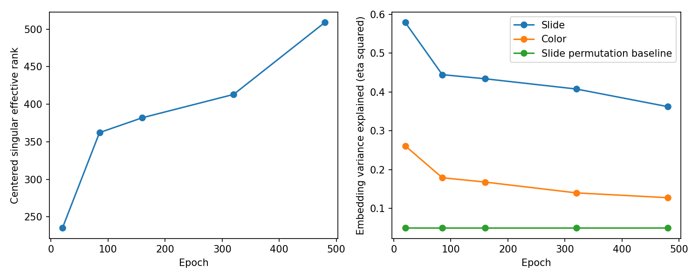
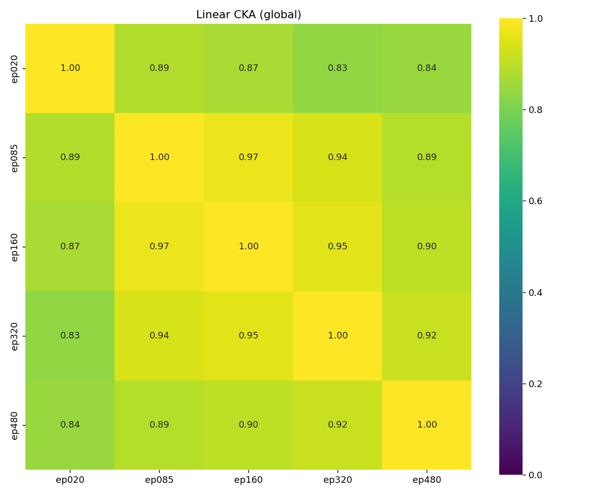
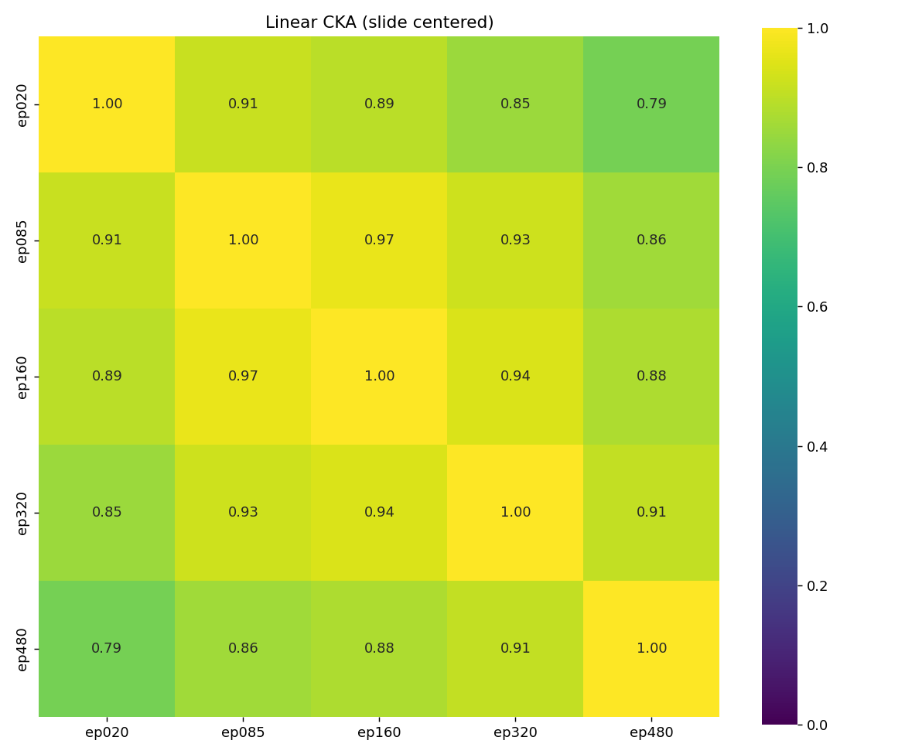
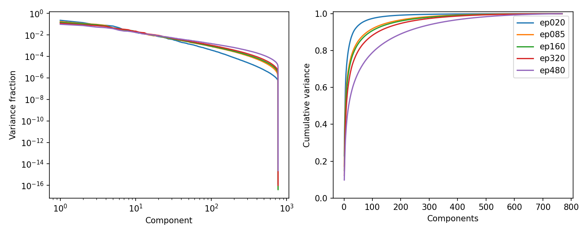
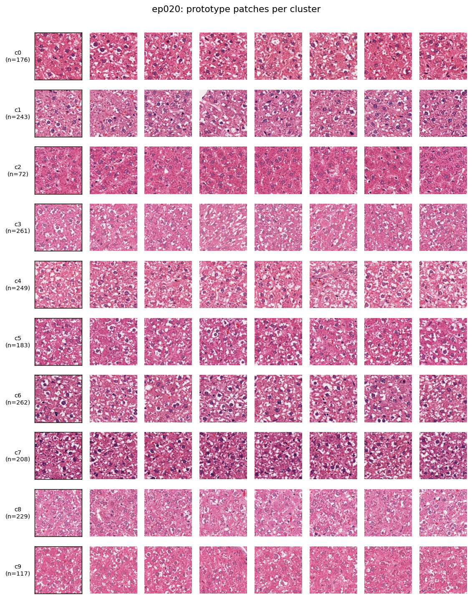
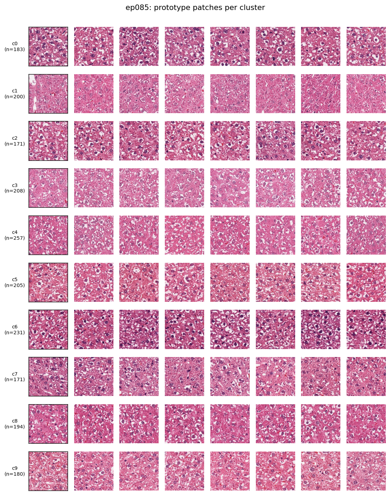
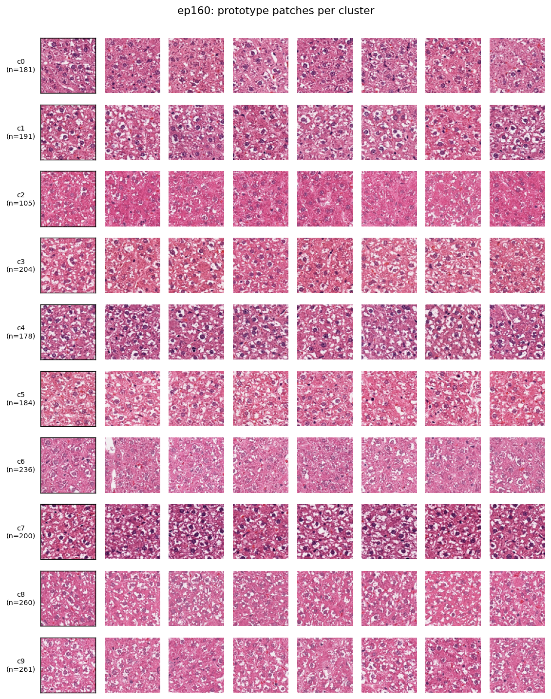
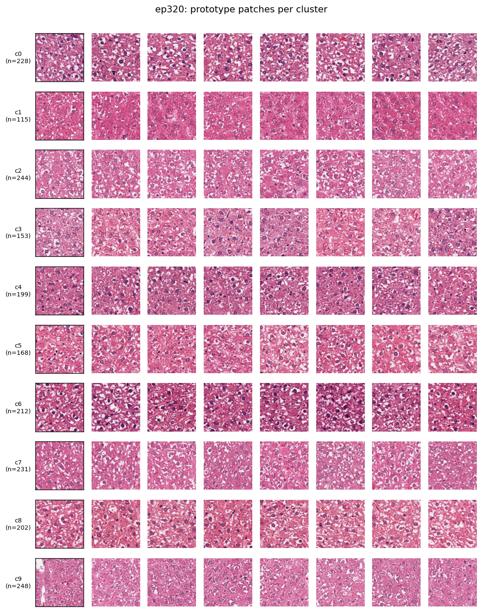
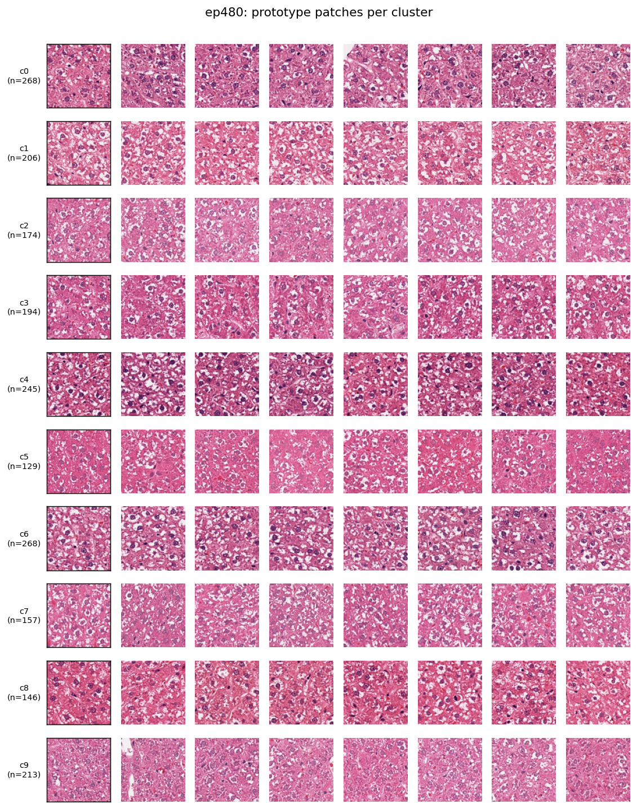

# DINO 0028: epoch 間 CKA と特徴の探索的解析

実行日: 2026-10-01、andre01。GPU 1枚で5本のチェックポイントを評価した。

旧 wsi-ad の shard_0000.tar から 100 スライド × 20 枚 = 2000 枚を固定し、student backbone で特徴抽出。
**事前学習の WSI との重複は未確認。独立した下流性能の評価ではない。**

## 特徴の推移

| epoch | 中心化後のeffective rank | η²_slide | η²_color | 平均コサイン類似度 |
|---:|---:|---:|---:|---:|
| 20 | 235.0 | 0.579 | 0.261 | 0.902 |
| 85 | 362.2 | 0.445 | 0.179 | 0.580 |
| 160 | 382.0 | 0.434 | 0.168 | 0.566 |
| 320 | 413.1 | 0.408 | 0.140 | 0.468 |
| 480 | 509.1 | 0.362 | 0.128 | 0.357 |

NaN/inf は全 epoch で0。effective rank は中心化した特徴の特異値のエントロピーから計算。
学習ログの別パッチ集合の値とは直接比較しない。η² は L2 正規化した特徴に対して計算。
η²_slide のラベル置換20回による参考値は約0.050（正式な検定・信頼区間ではない）。
色の分類は全 epoch 共通の平均RGBに対する k-means 10群で固定。
スライドIDには生物学的な差も含まれるため、η²_slide の低下だけで性能向上と解釈しない。

## CKA

| 比較 | 全体CKA | スライド平均を除いたCKA |
|---|---:|---:|
| ep020 → ep085 | 0.887 | 0.914 |
| ep085 → ep160 | 0.971 | 0.968 |
| ep160 → ep320 | 0.954 | 0.944 |
| ep320 → ep480 | 0.917 | 0.909 |

後者は各スライドの平均特徴を引いてから全パッチをまとめて計算したCKA。
スライド別に求めたCKAの平均とは異なる。各スライド20枚でのCKAは標本数の影響が大きいため採用しない。
通常の biased linear CKA で、値は標本数や特徴のスペクトルにも依存する。

## 解釈できる範囲

この画像集合では、epoch が進むと特徴の分布が広がり、スライド・色で説明される割合が低下した。
終盤も特徴が変化している。一方、病理所見の識別が改善したか、480 epoch が必要かは未判定。
CKA と η² だけで学習の良否や停止時期を決めず、ユーザーが用意するベンチマークと照合する。

詳細値: feature_health.csv / summary.json。入力画像ID・画像ハッシュ: patches_meta.json。
抽出設定・重みハッシュ・環境バージョン: extract_manifest.json。

## クラスタ代表画像

各 epoch の k-means 10群について重心に近い8枚を表示。クラスタ番号は epoch 間で対応していない。
所見ラベルが無いため、病変名の付与や所見別精度の評価は行っていない。

### ep020

### ep085

### ep160

### ep320

### ep480

